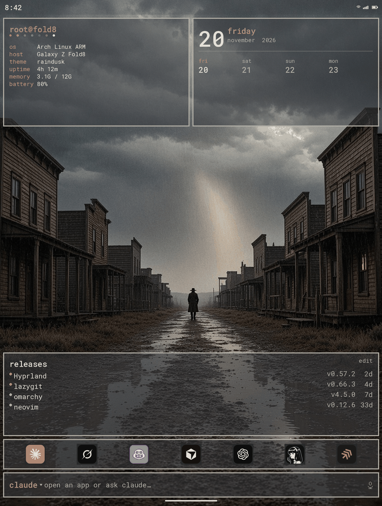

# raindusk

storm light on a frontier main street, a high-noon standoff: wet timber, cream type, tarnished-copper accent



## Palette

| Key | Value |
|-----|-------|
| `mode` | `dark` |
| `accent` | `#d4a06a` |
| `selection` | `#4a4c50` |
| `muted` | `#b2aea4` |
| `background` | `#3a3c40` |
| `dark_background` | `#303234` |
| `darker_background` | `#26282a` |
| `lighter_background` | `#484a4e` |
| `foreground` | `#e8e2d6` |
| `dark_foreground` | `#b2aea4` |
| `light_foreground` | `#f0ebe2` |
| `bright_foreground` | `#f4efe6` |

Full `colors.toml`:

```toml
mode = "dark"

accent = "#d4a06a"
selection = "#4a4c50"
muted = "#b2aea4"

background = "#3a3c40"
dark_background = "#303234"
darker_background = "#26282a"
lighter_background = "#484a4e"

foreground = "#e8e2d6"
dark_foreground = "#b2aea4"
light_foreground = "#f0ebe2"
bright_foreground = "#f4efe6"

red = "#c45c52"
yellow = "#d4a06a"
orange = "#c47a4a"
green = "#7a8a6a"
cyan = "#6a8a8a"
blue = "#5a6a7a"
magenta = "#8a6a70"
brown = "#8a7060"

bright_red = "#d87870"
bright_yellow = "#e0b888"
bright_green = "#96a686"
bright_cyan = "#86a8a8"
bright_blue = "#7a8a9a"
bright_magenta = "#a88890"
```

## Install

Paste this URL into Omalauncher's theme install:

https://github.com/TheFifeDawg/omarchy-raindusk-theme

On an Omarchy laptop: **Install > Style > Theme**, paste the same URL.

## Wallpapers

The two wallpapers are AI-generated original scenes:

- `1-standoff.jpg` — looking down a muddy frontier main street at a silhouetted figure under a shaft of storm light
- `2-storm-road.jpg` — a wet high-desert road under storm light, with a mesa in the distance

They're sized 1848×2448 for the Samsung Galaxy Z Fold 8 inner screen and framed to center-crop cleanly to the cover screen (1248×1972).

## Extras

Includes a `btop.theme` built from Omarchy's template, so the palette carries over to btop on a laptop.

## License

MIT. See [LICENSE](LICENSE).
